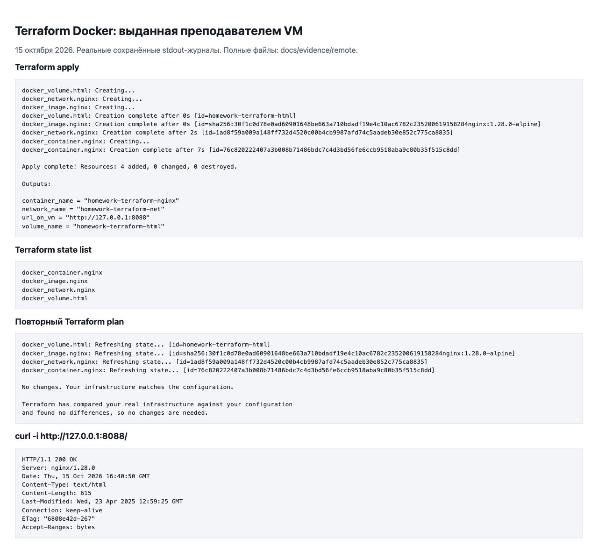
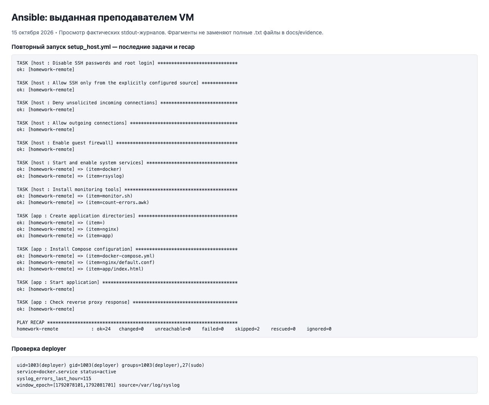
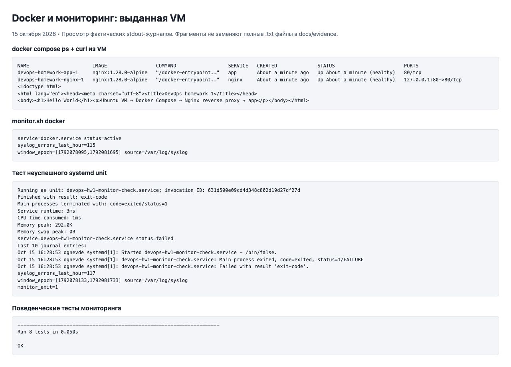

# ДЗ №1 — DevOps-инфраструктура

Стенд — выданная VM с Ubuntu 24.04 на VMware. По дополнению к заданию сначала настраивается Docker через Ansible, затем запускается Terraform с провайдером `kreuzwerker/docker`.

На сервере работают три контейнера:

- Nginx от Terraform — порт `8088`, отдельная сеть и том с HTML;
- Nginx reverse proxy от Compose — порт `80`;
- `app` от Compose — страница Hello World, доступная через reverse proxy.

## Схема

```text
Ubuntu VM
├── Terraform
│   └── homework-terraform-nginx
│       ├── 127.0.0.1:8088 → 80
│       ├── сеть homework-terraform-net
│       └── том homework-terraform-html
└── Compose
    ├── nginx: 127.0.0.1:80 → 80, сети frontend и app_net
    └── app: только сеть app_net
```

HTTP доступен внутри VM и через SSH-туннель. Вместо прямого `curl http://<VM_IP>` используется loopback, чтобы снаружи оставить только SSH. Снаружи открыт SSH для одного адреса `/32`. Terraform обращается к Docker через `/var/run/docker.sock` и запускается с sudo.

## Файлы

```text
terraform/       контейнер Nginx, сеть, том, переменные и outputs
ansible/         настройка сервера и запуск Compose
compose/         reverse proxy и страница Hello World
scripts/         мониторинг, SSH и установка provider
tests/          тесты мониторинга
docs/evidence/  вывод команд и скриншоты
```

## Ansible

На компьютере, с которого запускается Ansible:

```bash
python3 -m venv .venv
source .venv/bin/activate
pip install 'ansible-core>=2.19,<2.20'
ansible-galaxy collection install -r ansible/requirements.yml
mkdir -p .runtime
chmod 700 .runtime
cp ansible/inventory.ini.example .runtime/remote.ini
```

В inventory нужно указать IP сервера, пользователя, путь к ключу и known_hosts. `ssh_allowed_cidr` — исходящий IP клиента, который сервер видит в `SSH_CONNECTION`.

Для работы используется отдельный SSH-ключ `.runtime/id_ed25519_homework`. На новом стенде его нужно создать через `ssh-keygen -t ed25519 -f .runtime/id_ed25519_homework`, добавить публичную часть в `authorized_keys` и проверить вход. Ключ сервера нужно сверить и записать в `.runtime/remote-known-hosts`.

```bash
cd ansible
ansible-playbook -i ../.runtime/remote.ini setup_host.yml
ansible-playbook -i ../.runtime/remote.ini setup_host.yml
cd ..
```

Playbook создаёт `deployer` с sudo без пароля, устанавливает Docker и Compose, включает Docker и rsyslog, настраивает UFW и SSH. Затем копирует приложение в `/opt/app`, запускает контейнеры и проверяет HTTP-ответ.

Для `deployer` можно передать публичный ключ через переменную `deployer_public_key`. На этом стенде она задавалась файлом `-e @../.runtime/remote-vars.yml`. Без этой переменной копируются публичные ключи пользователя, от которого выполняется настройка.

После настройки вход по паролю и root-login отключены. Подключение с компьютера, где лежит ключ:

```bash
./scripts/ssh-homework.sh student@111.88.162.91
./scripts/ssh-homework.sh deployer@111.88.162.91
```

Скрипт использует только ключ домашки, без SSH-agent. Если исходящий IP изменится, нужно обновить правило UFW через действующий сеанс или консоль VM. Ключ, inventory, state и планы Terraform добавлены в `.gitignore`; их резервные копии хранятся отдельно.

## Terraform

Terraform запускается на VM после Ansible. Версия на стенде — 1.13.5, Docker provider — 4.6.0. Бинарник находится в `/home/student/homework-01-tools/terraform`, конфигурация — в `/home/student/homework-01/terraform`.

Для нового стенда Terraform можно установить по [инструкции HashiCorp](https://developer.hashicorp.com/terraform/install). Здесь архив Linux AMD64 скачан с [зеркала Yandex Cloud](https://hashicorp-releases.yandexcloud.net/terraform/1.13.5/), SHA256 проверена по файлу контрольных сумм.

Каталог `terraform/` вместе с `.terraform.lock.hcl` нужно скопировать на VM. Команды из корня проекта на VM:

```bash
sudo terraform -chdir=terraform init
sudo terraform -chdir=terraform fmt -check
sudo terraform -chdir=terraform validate
sudo terraform -chdir=terraform plan -out=homework.tfplan
sudo terraform -chdir=terraform apply homework.tfplan
sudo terraform -chdir=terraform state list
sudo terraform -chdir=terraform plan -detailed-exitcode
curl -i http://127.0.0.1:8088/
```

На текущем сервере вместо `terraform` используется полный путь `/home/student/homework-01-tools/terraform`.

В `main.tf` описаны четыре ресурса: образ, контейнер, сеть и том. При первом подключении Docker копирует стандартную страницу Nginx в пустой том. В контейнере том подключён к `/usr/share/nginx/html` только для чтения. Порт по умолчанию — `8088`; его можно изменить в `terraform/terraform.tfvars`, например `http_port = 8089`.

При установке provider реестр `registry.terraform.io` возвращал 404. Для загрузки из GitHub есть скрипт:

```bash
bash scripts/prepare-provider-mirror.sh
sudo env TF_CLI_CONFIG_FILE="$PWD/.runtime/terraform.tfrc" \
  terraform -chdir=terraform init
```

Он скачивает релиз provider 4.6.0, сверяет SHA256 и создаёт локальное зеркало. Lock-файл рассчитан на `linux_amd64`. Для другой платформы понадобятся дополнительные контрольные суммы через `terraform providers lock`.

State хранится на VM рядом с конфигурацией. `terraform destroy` удалит управляемые контейнер, сеть и том вместе с данными. На контейнеры Compose эта команда не влияет.

## Compose

Проверка на VM:

```bash
cd /opt/app
sudo docker compose ps
sudo docker compose config --quiet
curl -i http://127.0.0.1/
```

Reverse proxy пересылает запросы в `app:80`. У `app` нет опубликованного порта, он подключён только к внутренней сети `app_net`. У proxy также есть сеть `frontend`. Terraform-контейнер использует свою сеть.

## Мониторинг

```bash
sudo /usr/local/bin/monitor.sh docker
sudo /usr/local/bin/monitor.sh nonexistent-homework-unit
```

Скрипт принимает имя сервиса и проверяет его через systemd. Если сервис неактивен, выводятся последние 10 строк journal. Затем `grep` и GNU awk считают строки с признаками ошибок в syslog за последний час.

Коды возврата: `0` — сервис активен, `1` — неактивен, `2` — ошибка вызова или чтения лога, `3` — unit не найден. Число ошибок в syslog выводится отдельно и не меняет статус сервиса.

Поддерживаются даты RFC3164 и RFC3339, часовые пояса и переход года. После ротации читается только текущий `/var/log/syslog`. Для тестов путь и время можно задать через `SYSLOG_PATH` и `MONITOR_NOW`.

```bash
# На Mac для тестов нужен GNU awk: brew install gawk
python3 -m unittest discover -s tests -v
```

На Mac тесты подставляют команды systemd. На сервере дополнительно проверены работающий Docker и временный сервис с ошибкой запуска.

## Доступ к страницам с Mac

Из корня проекта:

```bash
ssh -F /dev/null -o IdentityAgent=none -o IdentitiesOnly=yes \
  -i .runtime/id_ed25519_homework \
  -o UserKnownHostsFile=.runtime/remote-known-hosts -o StrictHostKeyChecking=yes \
  -N -L 127.0.0.1:8081:127.0.0.1:80 \
     -L 127.0.0.1:8088:127.0.0.1:8088 student@111.88.162.91
```

Пока туннель открыт, в другом терминале:

```bash
curl -i http://127.0.0.1:8088/  # Nginx от Terraform
curl -i http://127.0.0.1:8081/  # Hello World через Compose
```

## Результаты

Проверки от 15 октября 2026 года:

| Проверка | Результат | Вывод команды |
|---|---|---|
| Повторный Ansible | `ok=24 changed=0 failed=0` | [лог](docs/evidence/remote/ansible-second-run.txt) |
| Terraform plan/apply | созданы 4 ресурса | [plan](docs/evidence/remote/terraform-plan.txt), [apply](docs/evidence/remote/terraform-apply.txt) |
| State и повторный plan | 4 ресурса, `No changes` | [state](docs/evidence/remote/terraform-state.txt), [plan](docs/evidence/remote/terraform-no-changes.txt) |
| Nginx на 8088, сеть и том | `200 OK`, том подключён, сети разделены | [curl и inspect](docs/evidence/remote/terraform-runtime.txt) |
| HTTP через SSH-туннель | `200 OK` | [curl с Mac](docs/evidence/remote/terraform-curl-from-mac.txt) |
| Compose | оба контейнера healthy, ответ Hello World | [ps и curl](docs/evidence/remote/compose-and-curl.txt) |
| deployer | SSH и sudo работают | [лог](docs/evidence/remote/deployer.txt) |
| Мониторинг | active для Docker, exit 1 для failed-unit | [Docker](docs/evidence/remote/monitor-docker.txt), [failed-unit](docs/evidence/remote/monitor-inactive.txt) |
| Тесты | 8 тестов прошли на Mac и VM | [Mac](docs/evidence/monitor-tests-local.txt), [VM](docs/evidence/remote/monitor-tests.txt) |

В логе мониторинга счётчик ошибок не нулевой. Во время установки containerd писал ошибки блокировки слоёв при параллельном скачивании образа, а тестовый failed-unit добавил ещё две записи. После установки контейнеры перешли в healthy. Счётчик показывает количество подходящих строк за час.

На скриншотах ниже открыт сохранённый вывод команд. Полные логи лежат по ссылкам в таблице. Последний скриншот — страница приложения через SSH-туннель.






## Git

Основная работа сделана в ветке `feature/infra-setup` и слита в `main` через [PR №1](https://github.com/ognevde17/devops/pull/1). На merge-коммите стоит тег `v0.1.0`.

[Репозиторий](https://github.com/ognevde17/devops) · [Самопроверка](docs/SELF_REVIEW.md)

## Вопросы по работе

- **Зачем state?** Он связывает ресурсы из `.tf` с объектами Docker. Без него контейнеры останутся, но Terraform потеряет эту связь. Восстановление — из копии state или через import.
- **Чем отличаются инструменты?** Terraform управляет ресурсами, Ansible настраивает хост через модули, Bash выполняет команды по порядку.
- **Как проверена идемпотентность?** Второй запуск Ansible дал `changed=0`, повторный Terraform plan не предложил изменений.
- **Что будет, если сервис не найден или лог пуст?** Для отсутствующего unit скрипт возвращает код 3. Пустой syslog даёт 0 ошибок; недоступный файл — код 2.
- **Как ограничен доступ?** SSH разрешён с одного IP и по ключу. HTTP слушает loopback, Docker API доступен через Unix-сокет. У deployer есть полный sudo по условию задания.

## Документация

- [Terraform Docker provider](https://github.com/kreuzwerker/terraform-provider-docker)
- [Релиз provider 4.6.0](https://github.com/kreuzwerker/terraform-provider-docker/releases/tag/v4.6.0)
- [Установка Docker на Ubuntu](https://docs.docker.com/engine/install/ubuntu/)
- [Модуль Ansible docker_compose_v2](https://docs.ansible.com/projects/ansible/latest/collections/community/docker/docker_compose_v2_module.html)
